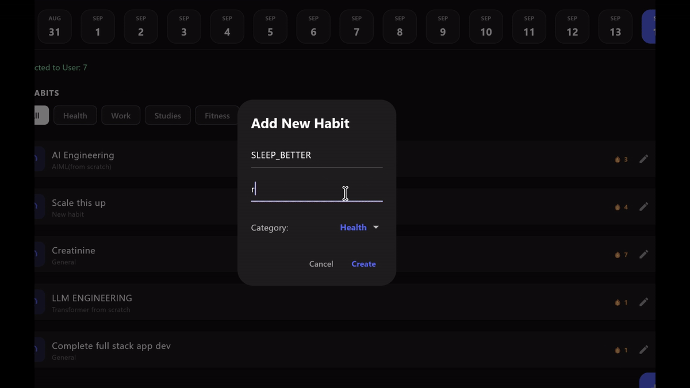

# 🌟 Habit Tracker

<p align="center">
  <strong>A cross-platform habit and productivity application built with Flutter, Spring Boot, PostgreSQL, and AI-assisted journaling.</strong>
</p>

<p align="center">
  
  
  
  
</p>

---

## 🎥 Demo

<p align="center">
  
</p>

<p align="center">
  <sub>Habit management, calendar history, journaling, priority tasks, analytics, and the Command Center workflow.</sub>
</p>

---

## 🧭 Overview

Habit Tracker is a full-stack productivity application for managing **habits, tasks, journals, calendar history, and personal progress** across supported platforms.

The application uses a Flutter client connected to a Spring Boot REST API, with PostgreSQL providing persistent storage and Gemini supporting AI-assisted journal processing.

> 🟢 **Current repository:** stable cloud-backed implementation.

---

## ✨ Highlights

| | Capability | Description |
|---|---|---|
| 🎯 | **Habit Management** | Create, update, delete, check in, and track habits |
| ✅ | **Task Management** | Manage tasks with priorities and completion states |
| 📅 | **Calendar History** | Review activity across previous dates |
| 📝 | **Journaling** | Create and manage personal journal entries |
| 🤖 | **AI Assistance** | Gemini-powered journal processing |
| 📊 | **Analytics** | Inspect progress and historical activity |
| 📁 | **Media Uploads** | Upload and serve media through the backend |
| 🌐 | **Cross-Platform** | Android, iOS, Web, Linux, macOS, and Windows |

---

## 🏗️ Architecture

```text
                    ┌───────────────────────┐
                    │     Flutter Client    │
                    │                       │
                    │ Habits · Tasks        │
                    │ Analytics · Journal   │
                    │ Calendar · UI         │
                    └───────────┬───────────┘
                                │
                                │ REST API
                                ▼
                    ┌───────────────────────┐
                    │    Spring Boot API    │
                    │                       │
                    │ Auth · Habits         │
                    │ Tasks · Journal       │
                    │ Uploads               │
                    └───────────┬───────────┘
                                │
                                ▼
                    ┌───────────────────────┐
                    │      PostgreSQL       │
                    └───────────────────────┘
                                │
                                │ AI-assisted
                                │ journal processing
                                ▼
                         ┌──────────────┐
                         │  Gemini API  │
                         └──────────────┘
```

---

## 🧩 Product Areas

### Command Center
A consolidated workspace for habits, task priorities, daily activity, and progress.

### Calendar
Navigate previous dates and review historical activity.

### Journal
Record notes and journal entries alongside daily productivity data.

### Analytics
Inspect habit completion and other historical progress indicators.

### AI-Assisted Journaling
Use Gemini-backed processing to augment the journaling workflow.

---

## 🎯 Project Goal

The project explores what happens when a habit tracker is treated as a real full-stack system rather than a local-only UI exercise:

```text
cross-platform client
        ↓
REST backend
        ↓
persistent relational data
        ↓
AI-assisted features
        ↓
history + analytics
```

---

## 📌 Status

The repository represents the stable cloud-backed implementation of the application.

---

<div align="center">

**Track consistently. Understand the pattern. Improve deliberately.**

</div>
